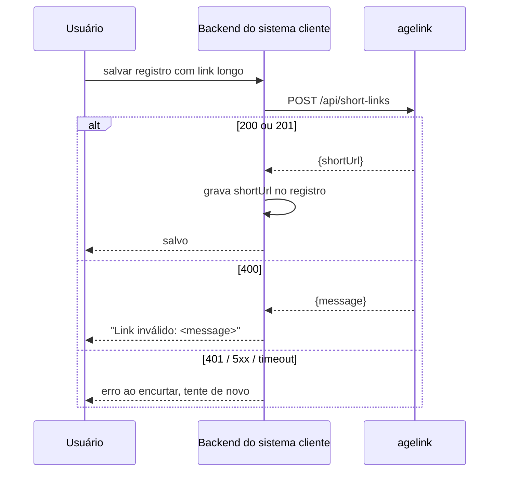

# Integração com sistemas externos

> **Contém:** como um sistema cliente (o sistema de itens ou qualquer outro backend) chama o agelink, com exemplos em curl, Node.js, Python e PHP.
> **Origem:** contrato em [api/README.md](README.md).

## Como integrar

1. **Peça uma API key** ao operador do agelink e guarde no ambiente do backend (ex.: `AGELINK_API_KEY`), junto com a base (`AGELINK_URL=https://lnk.exemplo.com`).
2. **Chame no momento de salvar o registro que tem o link**, no backend. Nunca do navegador: a chave vazaria.
3. **Grave a `shortUrl` no registro** e use-a onde usaria o link original. Não chame o agelink a cada exibição.
4. **Trate 200 e 201 como sucesso.** 200 significa que a URL já tinha código; o resultado é o mesmo.
5. **Defina timeout** (sugestão: 5 s) e **repita só em erro de rede ou 5xx**, no máximo 2 vezes. Repetir é seguro porque a mesma URL devolve o mesmo código.
6. **400 é erro de entrada** (link inválido ou de domínio não permitido): mostre a mensagem e não salve. **401 é erro de configuração** (chave errada): registre no log e avise o operador.



## curl

```bash
curl -sS -X POST "$AGELINK_URL/api/short-links" \
  -H "Content-Type: application/json" \
  -H "X-API-Key: $AGELINK_API_KEY" \
  -d '{"url":"https://www.exemplo.com.br/relatorios/2026/resultado-final?turma=3B&utm_source=email"}'
```

```json
{"code":"aB3xK9p","shortUrl":"https://lnk.exemplo.com/aB3xK9p","url":"https://www.exemplo.com.br/relatorios/2026/resultado-final?turma=3B&utm_source=email","createdAt":"2026-11-18T20:41:07.512Z"}
```

Testar o redirect:

```bash
curl -sI "$AGELINK_URL/aB3xK9p"
# HTTP/1.1 302 Found
# Location: https://www.exemplo.com.br/relatorios/2026/resultado-final?turma=3B&utm_source=email
```

## Node.js / TypeScript (fetch nativo, Node 18+)

```ts
export async function encurtar(url: string): Promise<string> {
  for (let tentativa = 0; ; tentativa++) {
    let res: Response;
    try {
      res = await fetch(`${process.env.AGELINK_URL}/api/short-links`, {
        method: 'POST',
        headers: {
          'Content-Type': 'application/json',
          'X-API-Key': process.env.AGELINK_API_KEY!,
        },
        body: JSON.stringify({ url }),
        signal: AbortSignal.timeout(5000),
      });
    } catch (erro) {
      if (tentativa < 2) continue; // rede/timeout: repetir é seguro
      throw erro;
    }

    if (res.ok) return (await res.json()).shortUrl; // 200 ou 201
    if (res.status >= 500 && tentativa < 2) continue;

    const corpo = await res.json().catch(() => ({}));
    throw new Error(`agelink ${res.status}: ${corpo.message ?? res.statusText}`);
  }
}

// ao salvar, por exemplo, a imagem de um item:
imagem.link = await encurtar(imagem.linkOriginal);
```

## Python (requests)

```python
import os
import requests

def encurtar(url: str) -> str:
    for tentativa in range(3):
        try:
            res = requests.post(
                f"{os.environ['AGELINK_URL']}/api/short-links",
                json={"url": url},
                headers={"X-API-Key": os.environ["AGELINK_API_KEY"]},
                timeout=5,
            )
        except requests.RequestException:
            if tentativa < 2:
                continue
            raise
        if res.status_code in (200, 201):
            return res.json()["shortUrl"]
        if res.status_code >= 500 and tentativa < 2:
            continue
        raise RuntimeError(f"agelink {res.status_code}: {res.json().get('message')}")
```

## PHP (cURL)

```php
function encurtar(string $url): string {
    $ch = curl_init(getenv('AGELINK_URL') . '/api/short-links');
    curl_setopt_array($ch, [
        CURLOPT_POST => true,
        CURLOPT_RETURNTRANSFER => true,
        CURLOPT_TIMEOUT => 5,
        CURLOPT_HTTPHEADER => [
            'Content-Type: application/json',
            'X-API-Key: ' . getenv('AGELINK_API_KEY'),
        ],
        CURLOPT_POSTFIELDS => json_encode(['url' => $url]),
    ]);
    $corpo = curl_exec($ch);
    $status = curl_getinfo($ch, CURLINFO_HTTP_CODE);
    curl_close($ch);

    if ($status === 200 || $status === 201) {
        return json_decode($corpo, true)['shortUrl'];
    }
    throw new RuntimeException("agelink $status: $corpo");
}
```

## Usando o link curto

O link curto substitui o original em qualquer lugar:

```html
<a href="https://lnk.exemplo.com/aB3xK9p">Ver resultado</a>

```

Também serve em e-mail, mensagem, QR code ou chamada de outro programa (`curl -L`, `fetch` seguem o redirect por padrão). O cliente segue o 302 sozinho; nada muda no front. Se o servidor de origem exigir `Referer` ou cookie, isso continua valendo, porque o conteúdo é baixado da origem, não do agelink.

## Checklist do integrador

- [ ] `AGELINK_URL` e `AGELINK_API_KEY` no ambiente do backend, fora do git.
- [ ] Chamada feita no salvar, nunca no exibir.
- [ ] `shortUrl` gravada no registro.
- [ ] 200 e 201 tratados como sucesso; 400 mostrado ao usuário.
- [ ] Timeout e no máximo 2 repetições em rede/5xx.
- [ ] Domínios de destino incluídos em `ALLOWED_DOMAINS`, se a lista estiver ativa.
