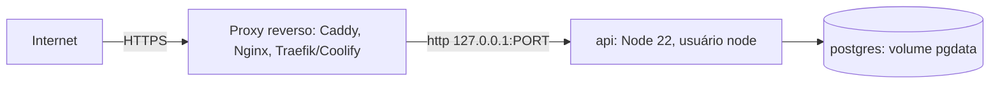

# Deploy em produção

> **Contém:** o que é publicado, checklist do `.env`, como subir, atualizar, fazer backup e o que fica de fora.
> **Origem:** `Dockerfile` e `docker-compose.yml` (perfil `prod`), testados localmente em 18/11/2026.

## O que sobe

Um servidor com Docker roda dois containers do mesmo `docker-compose.yml`:



| Container | Imagem | Detalhes |
| --- | --- | --- |
| `postgres` | `postgres:17-alpine` | Usuário, senha e banco vêm do `.env`. Dados no volume `pgdata`. Porta publicada só em `127.0.0.1`. |
| `api` | construída pelo `Dockerfile` | Multi-stage: compila no primeiro estágio; o final tem só dependências de produção, `dist/` e as migrações. Roda como usuário `node`. No start executa `prisma migrate deploy` e depois `node dist/main.js`. Healthcheck em `/api/health`. Porta publicada só em `127.0.0.1`. |

Os dois têm `restart: unless-stopped`. A API só sobe depois do Postgres saudável.

## Checklist do `.env` de produção

Copie o `.env.example` para `.env` **no servidor** (o arquivo nunca entra no git nem na imagem) e ajuste:

- [ ] `POSTGRES_PASSWORD`: senha forte (ex.: `npm run -s key` ou `openssl rand -base64 32`).
- [ ] `POSTGRES_USER` / `POSTGRES_DB`: à vontade. Definidos **antes** do primeiro `up`: depois que o volume existe, mudar aqui não muda o banco.
- [ ] `POSTGRES_HOST`: pode ficar `localhost`; o compose força `postgres` dentro do container da API.
- [ ] `PORT`: porta interna em que o proxy vai encaminhar (ex.: `3010`).
- [ ] `PUBLIC_BASE_URL`: domínio público final, com `https://`, sem barra final (ex.: `https://lnk.seudominio.com`). **Escolha uma vez:** ele fica gravado em todos os links curtos já entregues.
- [ ] `API_KEYS`: uma chave por sistema cliente, gerada com `npm run -s key`.
- [ ] `ALLOWED_DOMAINS`: vazio aceita qualquer link; preencha se quiser restringir.

## Subir

```bash
git clone <repo> agelink && cd agelink
cp .env.example .env && nano .env        # checklist acima
docker compose --profile prod up -d --build --wait
docker compose ps                        # api e postgres "healthy"
curl http://127.0.0.1:3010/api/health    # {"status":"ok"}
```

Depois aponte o proxy para `127.0.0.1:<PORT>`. Exemplo com Caddy (HTTPS automático):

```
lnk.seudominio.com {
    reverse_proxy 127.0.0.1:3010
}
```

Se o proxy roda em container na mesma rede do compose (Traefik, Coolify), ele aponta para `api:<PORT>` e a publicação em `127.0.0.1` nem é usada.

## Atualizar

```bash
git pull
docker compose --profile prod up -d --build --wait
```

A imagem nova aplica as migrações pendentes ao iniciar. Há alguns segundos de indisponibilidade na troca do container.

## Backup e restauração

```bash
# backup (rodar por cron, guardar fora do servidor)
docker compose exec -T postgres sh -c 'pg_dump -U "$POSTGRES_USER" -d "$POSTGRES_DB" -Fc' > agelink-$(date +%F).dump

# restauração
docker compose exec -T postgres sh -c 'pg_restore -U "$POSTGRES_USER" -d "$POSTGRES_DB" --clean --if-exists' < agelink-AAAA-MM-DD.dump
```

Perder o banco quebra **todos** os links curtos já publicados: o backup não é opcional.

## Comandos úteis

| Comando | O quê |
| --- | --- |
| `docker compose logs -f api` | Logs da API |
| `docker compose --profile prod restart api` | Reinicia a API (relê o `.env`, por exemplo após trocar `API_KEYS`) |
| `docker compose --profile prod down` | Para tudo, mantém os dados |
| `docker compose --profile prod down -v` | Para tudo e **apaga o banco** |

## Fora desta preparação

- **HTTPS:** fica no proxy reverso; a API fala só HTTP.
- **Pipeline de CI/CD:** o deploy é `git pull` + `up --build` manual.
- **Várias réplicas da API:** a migração no start supõe uma instância; com réplicas, rodar `prisma migrate deploy` num passo separado antes de trocar os containers.
- **Rate limit no redirect:** não há; se necessário, configurar no proxy.
