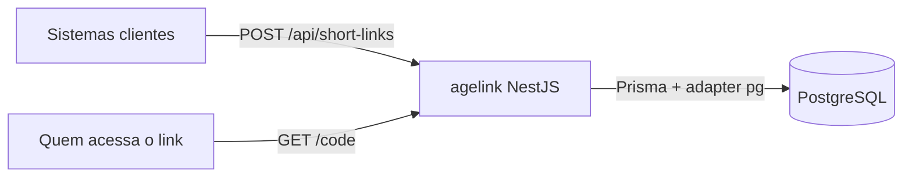

# Arquitetura — visão geral

> **Contém:** componentes, fluxo de uma requisição e os módulos do código com o que cada um tem.
> **Origem:** estrutura criada na Etapa 00.

## Componentes

**Uma API NestJS e um PostgreSQL.** Sem fila, cache ou worker: encurtar é um `SELECT` e talvez um `INSERT`; redirecionar é um `SELECT` por chave primária.



## Módulos

```
src/
├── main.ts                     # sobe o Nest; lê o .env fora do Docker
├── app.module.ts               # junta PrismaModule e ShortLinksModule
├── health.controller.ts        # GET /api/health
├── prisma/
│   ├── prisma.module.ts        # módulo global
│   ├── prisma.service.ts       # PrismaClient com adapter pg
│   └── database-url.ts         # monta a conexão a partir das POSTGRES_* (ou usa DATABASE_URL)
├── auth/
│   └── api-key.guard.ts        # valida X-API-Key (RN07)
├── short-links/
│   ├── short-links.module.ts
│   ├── short-links.controller.ts   # POST /api/short-links (protegido)
│   ├── redirect.controller.ts      # GET /:code (público)
│   ├── short-links.service.ts      # regras RN01–RN06
│   └── dto/create-short-link.dto.ts
└── generated/prisma/           # client gerado pelo Prisma (fora do git)
```

| Módulo / arquivo | O que tem | Depende de |
| --- | --- | --- |
| `AppModule` | Importa os módulos abaixo e registra o `HealthController`. | todos |
| `HealthController` | `GET /api/health`: roda `SELECT 1` e devolve `{"status":"ok"}`. Serve para o healthcheck do deploy. | `PrismaService` |
| `PrismaModule` (global) | `PrismaService`, que estende o `PrismaClient` gerado e conecta com `@prisma/adapter-pg` usando `databaseUrl()` (monta a conexão a partir das `POSTGRES_*`, ou usa `DATABASE_URL` se existir). Fecha a conexão no shutdown. | — |
| `auth/ApiKeyGuard` | Guard aplicado com `@UseGuards` no `ShortLinksController`. Lê `X-API-Key` e compara o SHA-256 dela, em tempo constante, com o SHA-256 de cada chave de `API_KEYS` (o hash iguala os tamanhos, então nem o tamanho da chave vaza); 401 se nenhuma bate. Não é módulo: é uma classe só, sem estado. | — |
| `ShortLinksModule` | Dois controllers e um service. | `PrismaService` |
| ↳ `ShortLinksController` | Rota `api/short-links`, protegida pelo guard. `POST` recebe `CreateShortLinkDto`, chama `shorten` e responde 201 ou 200 conforme o `created` devolvido. | `ShortLinksService` |
| ↳ `RedirectController` | Rota raiz `:code`, pública. Chama `resolve` e responde 302 com `@Redirect()`. | `ShortLinksService` |
| ↳ `ShortLinksService` | `shorten(url)` → `{ link, created }`: valida (RN01–RN03), normaliza, calcula o SHA-256, deduplica (RN05), gera código com nanoid e repete em colisão (RN04). `resolve(code)`: valida o formato e busca a URL, ou 404 (RN06). | `PrismaService`, `nanoid`, `node:crypto` |

As rotas da API ficam sob `/api/…` e o redirect na raiz (`/{code}`), para a URL curta ser a menor possível. Não há conflito: `/api/health` tem dois segmentos e `/:code` casa só um.

## Fluxo de `POST /api/short-links`

1. `ApiKeyGuard` confere a chave (RN07).
2. `ShortLinksService.shorten` valida e normaliza a URL (RN01–RN03).
3. Busca `url_hash`; achou, devolve o existente (200).
4. Não achou: `nanoid(7)` e `INSERT`. Em erro de unicidade (`P2002`), relê pelo `url_hash`: achou → outra requisição gravou a mesma URL ao mesmo tempo, devolve esse registro com 200 (RN05); não achou → o conflito foi no `code`, sorteia de novo (RN04).
5. Monta `shortUrl = PUBLIC_BASE_URL + "/" + code`.

## Fluxo de `GET /{code}`

1. Formato inválido → 404 sem ir ao banco.
2. `findUnique({ where: { code } })`; não achou → 404.
3. 302 com `Location: url` (RN06).

Stack e como rodar: [stack.md](stack.md).
