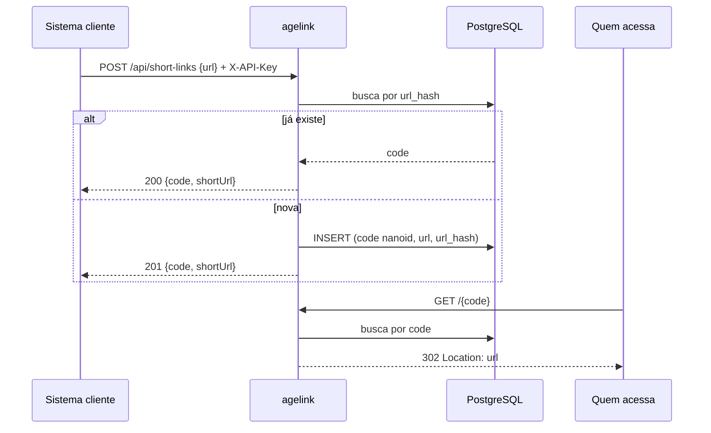

# Casos de uso

> **Contém:** CU01 (encurtar URL) e CU02 (acessar URL curta): ator, fluxos, pós-condição e RNs.
> **Origem:** pedido do dono do projeto em 18/11/2026.

## CU01 — Encurtar URL

- **Ator:** sistema cliente (ex.: sistema de itens). **Pré-condição:** tem uma API key válida.
- **Fluxo principal:**
  1. O sistema cliente tem um link longo para guardar ou exibir (ex.: o usuário salva uma imagem de um item).
  2. O backend envia `POST /api/short-links` com `{"url": "<link longo>"}` e o header `X-API-Key`.
  3. O agelink valida a chave (RN07) e a URL (RN01–RN03).
  4. O agelink normaliza a URL e procura o SHA-256 dela (RN05). Não encontrou: gera um código (RN04) e grava.
  5. Responde **201** com `code` e `shortUrl`.
  6. O sistema cliente grava `shortUrl` onde usaria o link longo.
- **Fluxos alternativos:**
  - 4a. A URL já foi encurtada antes, por qualquer cliente: responde **200** com o código existente.
  - 3a. Chave ausente ou inválida: **401**.
  - 3b. URL inválida, esquema diferente de http/https, domínio fora da lista ou URL do próprio agelink: **400**, nada é gravado.
- **Pós-condição:** existe exatamente um código para a URL. **RN:** RN01–RN05, RN07.

## CU02 — Acessar URL curta

- **Ator:** quem acessa o link: navegador (clique, `<a>`, ``, download) ou outro programa. **Pré-condição:** nenhuma; a rota é pública.
- **Fluxo principal:**
  1. O cliente HTTP pede `GET https://dominio/aB3xK9p`.
  2. O agelink busca a URL do código `aB3xK9p`.
  3. Responde **302** com `Location: <URL original>`.
  4. O cliente segue o redirect e recebe o conteúdo do servidor original (página, imagem, arquivo…).
- **Fluxos alternativos:**
  - 2a. Código fora do formato ou inexistente: **404**.
- **Pós-condição:** nada muda no banco. **RN:** RN06.

