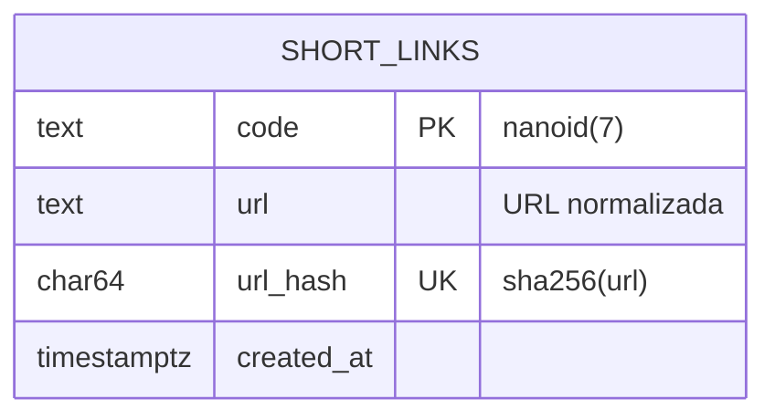

# Modelo de dados

> **Contém:** a tabela, seus campos e índices, e por que é assim.
> **Origem:** `prisma/schema.prisma` e migração `prisma/migrations/*_init`.

Uma tabela só.

```
short_links   code (PK), url, url_hash (único), created_at
```

| Campo | Tipo no Postgres | Prisma | Descrição |
| --- | --- | --- | --- |
| `code` | `text`, chave primária | `code String @id` | Código nanoid de 7 caracteres (RN04). É o caminho da URL curta. |
| `url` | `text` | `url String` | URL original já normalizada (RN05). Sem limite de tamanho no banco; o limite de 8192 é da API (RN02). |
| `url_hash` | `char(64)`, índice único | `urlHash String @unique` | SHA-256 em hex da URL normalizada. Garante a deduplicação (RN05). |
| `created_at` | `timestamptz(3)`, padrão `now()` | `createdAt DateTime` | Quando o link foi criado. |



## Decisões

- **O código é a chave primária.** As duas buscas da API são "por código" (redirect) e "por hash" (deduplicação); um `id` numérico seria um terceiro índice que ninguém consulta.
- **Índice no hash, não na URL.** Um índice B-tree do Postgres não aceita valores acima de cerca de 2,7 kB, e as URLs aqui podem chegar a 8 kB. O hash tem tamanho fixo de 64 caracteres.
- **Sem `updated_at`, contador de cliques ou expiração.** Link não muda (RN06) e estatística está fora do escopo ([visão](../produto/visao-e-escopo.md#fora-do-escopo)).

## Migrações

- Mudou o schema: `npx prisma migrate dev --name <descricao>` gera a migração e o client.
- Em produção: `npx prisma migrate deploy`.
- O client gerado fica em `src/generated/prisma/` (fora do git; `npx prisma generate` recria).
