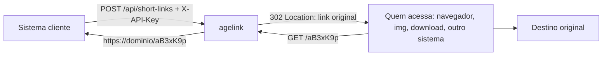

# Visão e escopo

> **Contém:** o problema, o que o agelink faz, quem usa e o que fica fora.
> **Origem:** pedido do dono do projeto em 18/11/2026; ampliado para encurtador geral no mesmo dia.

## O que é

O agelink é um **encurtador de URL de uso geral**: recebe qualquer link `http`/`https`, devolve um link curto (`https://dominio/aB3xK9p`) e redireciona quem acessa para o link original. Não importa o tipo de destino: página, imagem, PDF, vídeo, formulário ou API.

Por dentro, um encurtador é uma tabela de duas colunas: **código → URL original**. Encurtar grava o par; acessar o link curto faz o caminho reverso, busca a URL pelo código e responde com redirect.

## Por que existe

O primeiro cliente é o **sistema elaborador de itens de questões**. Lá, o usuário registra imagens pelo link, e esses links são enormes (URLs assinadas, links de drive, parâmetros de redimensionamento): acabam quebrando a imagem. Hoje o usuário abre um encurtador gratuito em outra aba, cola o link e traz o link curto de volta. Com o agelink, o sistema de itens chama a API ao salvar e grava o link curto direto, sem o usuário sair do sistema.

Nada na API é específico desse caso. Qualquer sistema interno com uma API key pode encurtar qualquer link.

## Quem usa

| Ator | Como usa |
| --- | --- |
| Sistema cliente (ex.: sistema de itens) | Backend chama `POST /api/short-links` com a API key e grava a `shortUrl` onde usaria o link original. |
| Quem acessa o link curto | Navegador (clique, barra de endereço, ``, `<a>`, download) ou outro programa. Segue o 302 sem credencial. |
| Operador | Sobe o serviço, gera e distribui as chaves e, se quiser, restringe os domínios de destino. |

## No escopo

- Encurtar URLs `http`/`https` de qualquer tipo de conteúdo, com código aleatório de 7 caracteres.
- Devolver o mesmo código quando a mesma URL é encurtada de novo.
- Redirecionar `GET /{code}` com 302.
- Restringir, opcionalmente, os domínios de destino, para a API não virar redirecionador aberto.

## Fora do escopo

- Interface web, contas de usuário, painel.
- Código personalizado (`/minha-pagina`), expiração, edição ou exclusão de link.
- Estatísticas de acesso.
- Hospedar ou fazer proxy do conteúdo: o agelink só redireciona; o conteúdo continua vindo do servidor original.
